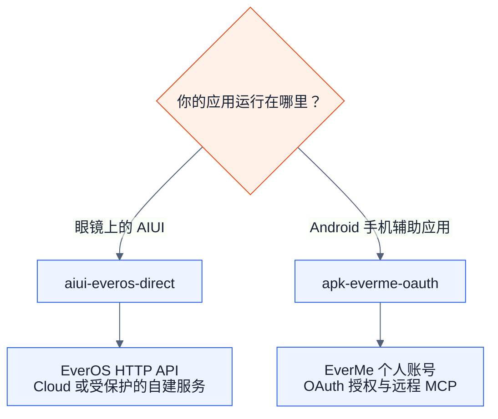
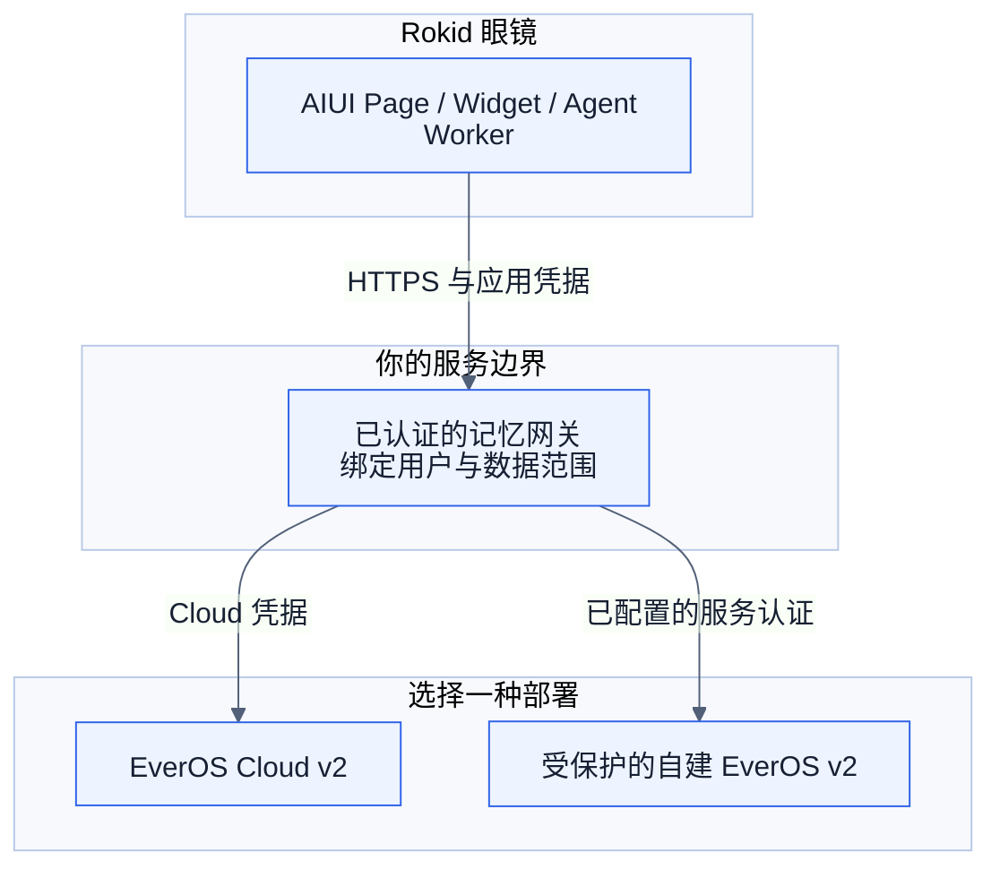
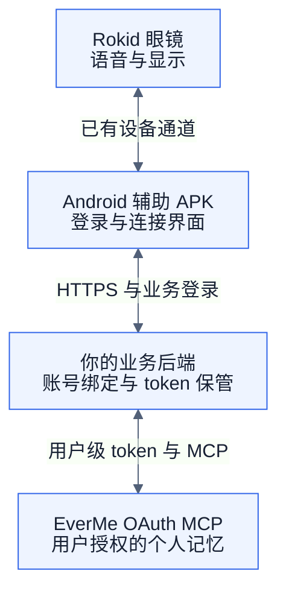
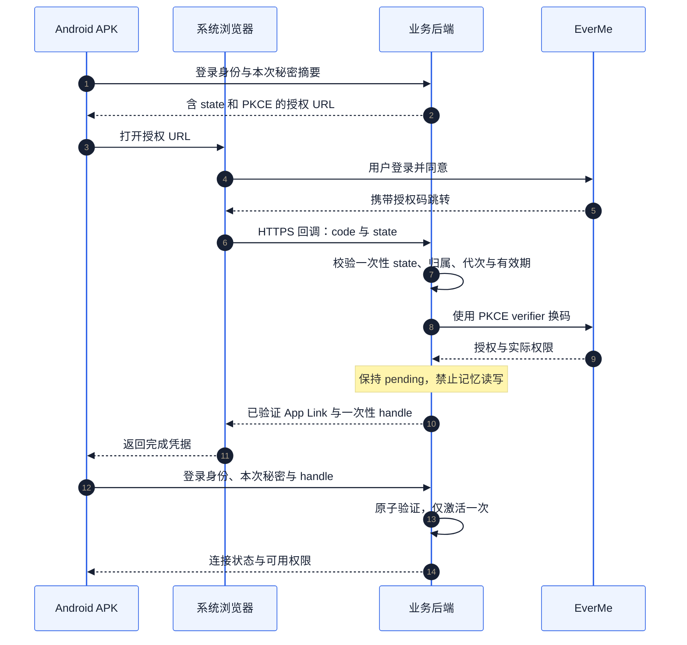
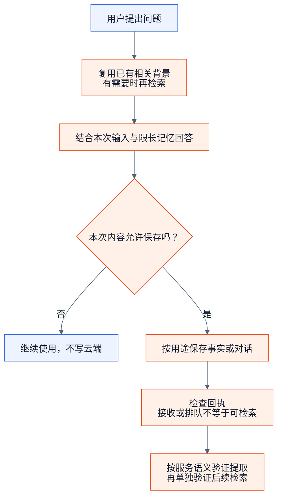

# Rokid 开发者：两条长期记忆接入路线

**简体中文** · [English](rokid-memory-skills.en.md) · [日本語](rokid-memory-skills.ja.md)

把长期记忆接到眼镜应用时，先选实际运行链路。本仓库提供两份可以独立复制、交给 AI 编程助手使用的 Skill，适用于新应用接入、既有项目改造和故障排查。

## 1. 先选路线



图中蓝色表示组成，橙色表示选择或操作步骤。图示是接入设计，不代表已经上线。

| 选择 | AIUI × EverOS | Android APK × EverMe |
| --- | --- | --- |
| Skill | [`aiui-everos-direct`](../skills/aiui-everos-direct/SKILL.md) | [`apk-everme-oauth`](../skills/apk-everme-oauth/SKILL.md) |
| 入口 | AIUI Page / Widget / Agent Worker | Android 手机辅助应用 |
| 接入方式 | AIUI HTTP 请求可达的 EverOS 服务 | 用户 OAuth 授权后调用远程 MCP |
| 手机 APK | 不作为依赖 | 承担登录入口、应用交互和眼镜连接 |
| 服务与凭据 | 确认云版或自建版、API 版本、地址和认证 | OAuth discovery、PKCE、token 生命周期、MCP 工具发现 |
| 典型任务 | 记住用户偏好，检索相关历史后生成回复 | 经用户同意使用个人记忆，辅助眼镜中的连续对话 |

AIUI 的“直连”表示不依赖手机 APK 转发，仍然需要眼镜可访问的服务。注册账号只是准备工作之一；服务开通、凭据、网络、用户隔离和真实读写都需要核验。普通应用的数据目录或 `user_id` 参数本身不构成访问控制。

APK 路线需要先与 EverMe 登记各环境的准确回调 URL、约定固定的 `client_name`，再执行客户端动态注册。后端除校验 state 和 PKCE，还须验证授权结果回到原浏览器会话或原 APK；只轮询“已连接”不足以防止转发授权链接造成账号错绑。具体要求见 APK Skill 的 OAuth 与后端参考。

这里采用上游正式名称 **EverOS / EverMe**。“Evermind OS”“Evermate”等口头称呼需要先按用户提供的实际服务地址确认，不能推导出另一套 API。EverMe 公开 CLI/plugin 和远程 OAuth MCP 也可能提供不同工具；应读取目标服务的发现结果。

## 2. AIUI：不依赖手机 APK

下面是面向多用户分发的推荐设计。网关由你的应用实现：验证登录身份、固定用户数据范围，并在服务端保管上游主密钥。



个人调试可在运行时提供自己的 Cloud key；**公开 AIX 不得内置共享 key**。网关不需要手机 APK。自建服务默认的无鉴权 localhost 入口不能直接当公网入口，眼镜上的 `127.0.0.1` 也不指向开发电脑。

先实现 `search → 生成回答 → add`，需要在会话结束时提取再调用 `flush`。固定 `app_id/project_id/user_id/session_id`，原始消息时间戳使用 **Unix 毫秒**；没有 embedding 的自建服务先明确用 `keyword` 搜索。

对应资料：[部署与版本](../skills/aiui-everos-direct/references/versions-and-sources.md)、[v2 请求与状态](../skills/aiui-everos-direct/references/api-v2.md)、[AIUI 适配](../skills/aiui-everos-direct/references/aiui-adapter.md)、[无密钥参考模块](../skills/aiui-everos-direct/assets/everos-client.mjs)。参考模块负责请求与响应处理，不包含你的网关、登录或持久队列。

## 3. APK：使用用户自己的 EverMe 记忆



EverMe 不负责建立蓝牙、麦克风采集、TTS 或 HUD；这些沿用已有 Rokid 应用通道并单独验证。先完成回调和固定名称登记，再做客户端动态注册（DCR）；按需要申请权限，并保存**实际授予的 scope**，写入需要 `mem:write`。

### 授权完成后，如何确认回到原 APK

下面展示后端代理方案中的 App Link 完成握手。已有受信浏览器登录会话的项目也可以使用浏览器会话绑定，详见后端参考。



完成凭据由后端独立生成且不可预测，不能通过轮询取得。没有原本地 attempt 秘密的 APK 无法完成绑定；EverMe token 和 PKCE verifier 始终保留在后端。转发授权链接给别人，不能把对方的记忆绑定到发起者账号。

激活后按 `initialize → notifications/initialized → tools/list → tools/call` 发现和调用工具，支持 JSON/SSE 响应。写入或刷新超时保留“结果未知”，不盲目重复发送。实现细节见 [OAuth/MCP](../skills/apk-everme-oauth/references/oauth-mcp.md)、[APK 与后端](../skills/apk-everme-oauth/references/android-backend.md)、[验收场景](../skills/apk-everme-oauth/references/acceptance.md)。

## 4. 一次对话怎样使用记忆

记忆负责召回相关偏好和历史决定。先复用本轮已有的相关上下文，确有需要时再用短主题搜索；旧记忆与用户本次陈述冲突时，优先本次陈述并保留不确定性。服务不可用时继续原功能，不编造历史。实时设备读数、正式日程和执行记录保留在原业务系统。下图把官方 Skill 的上下文与检索思路适配到有明确数据同意的应用。



| 目的 | AIUI / EverOS v2 | APK / 托管 EverMe MCP |
| --- | --- | --- |
| 读取相关历史 | `memory/search`，按需包含 profile | `mem_search`；`mem_context` 读取持久 Profile，通常每会话一次 |
| 记住明确偏好 | `memory/add` 提交获准保存的消息 | 优先 `mem_save_fact` |
| 保存对话 | `memory/add`，保持合法消息与说话者身份 | `mem_save_turn`，保留真实工具往返关系 |
| 请求提取 | 确认前序消息进入处理管线后 `memory/flush` | 按实际 schema 使用 `flush` 参数并核对回执 |

这是用途对照，不是可互换的请求体。`mem_save_turn` 成功不证明 Profile 更新；两种服务的“接收成功”都不能直接写成“下次一定能召回”。记忆内容是背景数据，不得用于改写权限或请求地址。

## 5. 取得与使用

```sh
git clone https://github.com/EasonZhu1997/Eason-Agent-Skills.git
```

1. 克隆或下载 [Eason-Agent-Skills](https://github.com/EasonZhu1997/Eason-Agent-Skills)。
2. 复制所需的整个 `skills/aiui-everos-direct` 或 `skills/apk-everme-oauth` 目录，包括 references、agents、LICENSE 和存在的示例文件。
3. 按你使用的 AI 编程助手的技能安装方式放入目录，或直接让助手先读取该目录中的 `SKILL.md`。不需要同时安装两份，也不要求安装作者的其他技能。
4. 提供你的项目、目标固件/SDK、选择的记忆服务和已经完成的验证。密钥使用本机安全配置，不写进聊天、仓库或公开安装包。

AIUI 调用示例：

```text
使用 $aiui-everos-direct，为我的 AIUI 项目接入 EverOS 长期记忆。
不依赖手机 APK。先核对现有 AIUI 网络 API、实际 EverOS 服务版本和用户隔离，
实现记忆写入与检索，给出可运行验证及未完成的眼镜实测项。
```

APK 调用示例：

```text
使用 $apk-everme-oauth，为我的 Android 手机辅助应用接入 EverMe，供 Rokid 眼镜对话使用。
沿用现有账号和后端，实现系统浏览器授权、PKCE、MCP 工具发现、刷新和解绑，
并验证账号切换、取消授权、网络超时与重复回调。先完成本地实现和测试。
```

排查示例：

```text
按对应 Skill 检查：写入请求成功但检索不到，或手机解绑后旧请求仍返回记忆。
先区分服务接受、处理完成、检索可见和客户端回调归属，不要直接循环重发写入。
```

| 阶段 | 要取得的证据 |
| --- | --- |
| 本地实现 | 可复现测试、账号隔离和错误状态 |
| 获准的服务联调 | 正确账号、实际权限、后端回执，以及不携带原聊天上下文的新会话召回 |
| 应用与眼镜联调 | 明确 AIX/APK 构建、固件/型号、语音与显示观察 |

从仓库根目录运行 `node --test skills/aiui-everos-direct/scripts/everos-client.test.mjs` 可检查 AIUI 参考模块。这是离线测试，不是眼镜接入成功证据。三种语言说明使用同一组 Skill 标识与共享技术参考。

## 来源与本次分享范围

包含可执行工作流程、版本与协议差异、通用集成方法、合成示例及验收清单。说明由公开上游资料和作者 AIUI/APK 项目经验整理；不附真实凭据、个人记忆或私有业务源码。

本次于 **2026-10-24** 阅读并借鉴以下官方 Skill，链接固定到实际核对的提交：

| 官方 Skill | 本指南借鉴的内容 |
| --- | --- |
| [EverOS search](https://github.com/EverMind-AI/Plugins/blob/3318dc1a2afcef3d3d804963941e8ce0bf9a3879/claude-code/skills/search/SKILL.md) | 按场景触发检索、保持用户身份一致、如实说明无结果 |
| [EverOS status](https://github.com/EverMind-AI/Plugins/blob/3318dc1a2afcef3d3d804963941e8ce0bf9a3879/claude-code/skills/status/SKILL.md) | 先检查服务可达性、身份与实际配置，再判断故障原因 |
| [EverMe memory-mcp](https://github.com/EverMind-AI/EverMe/blob/38afee5c89aad59f3c964fa861fc8fc6d003084a/plugins/memory-mcp/SKILL.md) | 以任务解释四类工具职责；实施时核对托管服务 schema |
| [EverMe memory-tools](https://github.com/EverMind-AI/EverMe/blob/38afee5c89aad59f3c964fa861fc8fc6d003084a/plugins/claude-code/skills/memory-tools.md) | 复用已有召回、短主题查询、区分保存回执与实际结果 |

官方桌面插件中的 hooks、loopback 服务和自动捕获属于对应宿主机制，不直接搬到 AIUI/APK。不同 EverMe 插件的工具与捕获方式也有差异，托管路线仍以 OAuth 手册和认证后的 `tools/list` 为准。本仓库两份 Skill 是开发接入指南，与 EverOS 从真实执行轨迹提炼的 `agent_skill` 不同。

Skill 文档与本地检查通过，只说明这些分享材料通过对应验证。账号授权、云端写入、正式应用构建、安装和物理眼镜效果仍须由使用者在自己的目标环境验证，不能从本仓库发布状态推断已经通过。

来源与验证范围见各技能的 references，以及 [发布验证记录](validation.md)。本项目为社区分享，许可证为 MIT；不代表 Rokid 或 EverMind 的官方产品认证。

*图解设计致谢：感谢 成都常顺鑫。*
