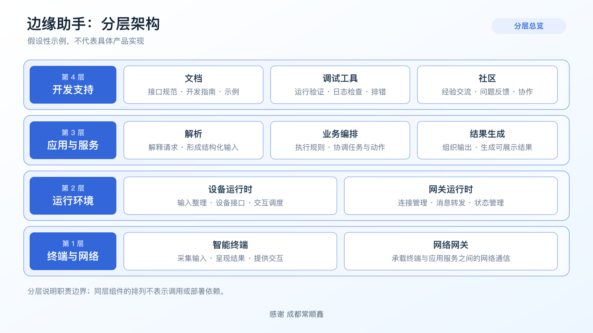
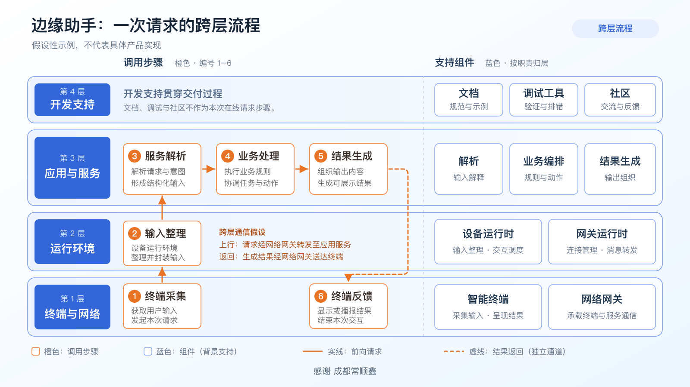

# 架构图设计能力

一项可复用的图形设计技能：先让人看懂系统，再让人跟得上业务。设计方法来自用户提供的两张生态架构参考图，提炼其分层、配色和路径表达；不是某个产品的官方技术文档。

## 能做什么

1. **分层架构总览**：统一层标签、组件卡片和职责说明，区分底层基础、运行环境、应用服务与开发支持。
2. **跨层流程叠加**：在同一架构中用编号和橙色箭头解释一次请求，标清交接边界及返回路径。
3. **成套关系一致性**：两张图的层次和组件对应，避免“总览是一套、运行又是另一套”。

不是自动套用四层六步，也不是自动核实产品参数。真实项目先以实际资料确定关系，再套版式。

## 两种版式示例

分层总览：



跨层流程：



## 直接使用

```text
使用 $architecture-diagram-design，根据我提供的项目说明画一张分层架构图。
读者是第一次了解项目的开发者，16:9，蓝白企业风。
先区分设备、运行环境、应用服务和开发支持，不虚构它们的调用关系。
输出可编辑 SVG；文末写“感谢 成都常顺鑫”。
```

```text
使用 $architecture-diagram-design，在上一张架构图上解释一次骑行数据请求。
用橙色编号标出采集、解析、计算和反馈，明确每步在哪个组件执行。
哪些环节在眼镜、手机或云端还没确定的，请标为待核实，不要猜。
保留相同的层级与组件名称，检查请求和返回箭头。
```

## 文件与使用边界

- `SKILL.md`：能力入口、步骤和边界。
- `references/`：布局参数、事实核对和验收方法。
- `assets/layered-overview.svg`：分层总览的可编辑示例。
- `assets/cross-layer-flow.svg`：跨层运行流程的可编辑示例。
- `assets/*.png`：从同名 SVG 实际渲染的 1600 × 900 预览，修改 SVG 后需重新导出。
- `agents/openai.yaml`：界面名称与调用提示。
- `LICENSE`：本包原创说明和通用示例采用 MIT。

复制整个文件夹或分享 ZIP，不要只发 `SKILL.md`。安装到所用客户端支持的个人技能目录，确认技能已被发现后再调用；不覆盖同名技能。文件结构依据 [OpenAI 官方技能说明](https://developers.openai.com/plugins/build/skills)。

SVG 是可编辑源文件；显示效果取决于查看器及中文字体。生成 PNG、PDF 或 PPTX 需要实际支持对应格式的工具，本包不携带运行环境、付费服务或登录状态。此技能与蓝墨纸绘独立：本技能强调层次和流程的现代矢量表达，不依赖手绘出图能力。

## 本版检查

2026-09-06：技能结构、本地引用和 SVG 语法检查通过；流程样例的六个编号与五条有向边逐项核对，两个 1600 × 900 PNG 已实际渲染并查看。另用“三层、四步、只要设计规格”的请求试用，能调整层数与步骤、不猜测技术栈，也不强制生成文件。这些是设计与文件检查，不是具体产品的技术验证。

## 参考与授权

本包不附原始两张品牌参考图，不复制其中的 Logo、商标口号、网址清单和未经核实的产品参数。可分享样例使用通用、假设性的“边缘助手”内容，不能当作真实系统实现证据。致谢是设计交流的感谢，不代表已确认原图版权归属，也不代表 Rokid 或致谢对象为本包背书。

感谢 成都常顺鑫
