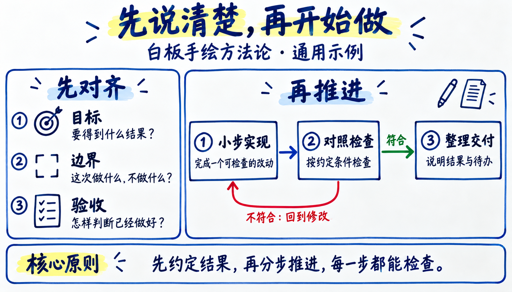

# 白板手绘

用白板与马克笔讲清知识、方法和工作流程：近白光滑板面、深色手写正文、蓝色结构、浅黄色重点，按需用红色提醒和绿色状态。一页讲一个问题，顶部提出主题，中部拆解关系，底部收束结论。

这是独立技能 `whiteboard-explainer`，可用于工作坊、课程插图、概念对比、角色矩阵与方法论讲解。默认 16:9 单页，也支持竖图和逐页独立输出的系列；主题不限定为编程。

## 示例效果



这张图演示如何先对齐目标、边界与验收，再沿步骤检查和返工；它是通用工作法示例，不表示某个真实项目已完成。图片由内置图像工具生成，准确提示词见 [示例生成记录](references/sample-prompt.md)。

## 怎么用

把整个技能目录交给支持技能的 AI 助手，先读取 [SKILL.md](SKILL.md)，再提供内容。无需安装同仓库的其他绘图技能。

```text
使用 $whiteboard-explainer，把这篇文章整理成一张白板手绘方法论信息图。
面向新手，采用深色马克笔字、蓝色分区和浅黄色重点，底部总结核心原则。
```

```text
使用 $whiteboard-explainer，画出“规划 → 实施 → 验收”的流程，未通过返回实施。
这是未来计划，还没有完成。用 9:16 竖版，不放人物。
```

```text
使用 $whiteboard-explainer，把需求、实现、验证的职责与交付整理成模块矩阵。
三者是分工关系，只给提纲与提示词，先不要生图。
```

## 包内资料

- [技能入口](SKILL.md)：整理内容、选择布局、生成和验收。
- [视觉规范](references/style-spec.md)：白板材质、马克笔笔触、浅色背景对比度。
- [组件库](references/components.md)：标题、节点、连线、状态和总结条。
- [布局与提示词](references/prompt-recipes.md)：流程、对比、分类及系列模板。
- [示例生成记录](references/sample-prompt.md)：包内预览图的提示词与实际验证范围。
- [MIT 许可](LICENSE)：复制单个技能时一并保留。

实际成图需要宿主的图片生成/编辑能力；缺少时可交付完整提示词。PNG 是位图预览，不是可编辑 SVG 或 PPT。技能自带文字规范，无需私有参考图、账号或 API 密钥文件。

相关风格：[粉笔板书](../chalkboard-explainer/README.md) 为深色黑板上的粉笔讲解；[蓝墨纸绘](../blue-ink-paper-diagram/README.md) 为暖白纸上的黑笔与蓝墨手绘。
